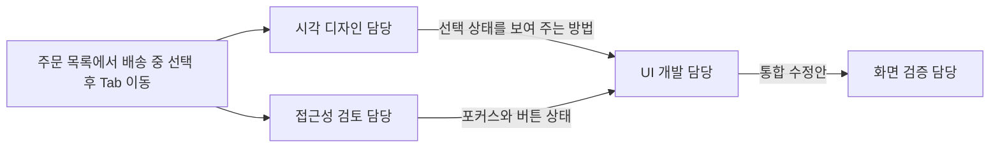

# AI Agent Workflow Studio

AI Agent Workflow Studio는 **AI 개발 경험이 없는 실무자와 학습자**가 Windows PC의 브라우저에서 사용하는 로컬 웹앱입니다. Agent는 지시에 따라 작업을 수행하는 AI입니다. 한국어 블록 편집기에서 작업 순서를 정하고 필요한 자료와 도구를 연결한 설계를 Workflow라고 합니다. 작업실에서 Workflow를 시험하고 완성한 Agent를 다른 사람과 공유할 수 있습니다.

[질문 한 건이 답변이 되기까지 (흐름도)](docs/DEVELOPER_GUIDE.ko.md#질문-한-건이-답변이-되기까지)

- **회의록 만들기** — **가이드 → 목적별로 만들기 → 업무 문서 만들기**에서 **회의록·업무 보고 → 이 업무로 설계하기**를 누르세요. 예시 메모를 그대로 두고 **기본 설계로 시작**을 누르면 회의록 Agent를 편집할 수 있습니다. 모델을 연결했다면 예시 메모로 시험해 확정된 업무가 표에 들어가는지, 메모에 없는 담당자나 기한은 ‘미정’으로 표시되는지 확인하세요. [회의 메모와 결과 예시](docs/WORKFLOW_USE_CASES.ko.md#meeting-notes)
- **내 자료로 답변 만들기** — **예제 템플릿**을 열고 **실습 수준**에서 **초급**, **실습 주제**에서 **도서관**을 고르세요. **내 자료로 안내하기 → 내 사본으로 시작**을 누르세요. “책을 몇 권까지 빌릴 수 있나요?”라고 물어 첫 답변이 3권인지 확인하세요. **도서관 이용규정**에서 3권을 5권으로 고치고 **변경 적용**을 누르세요. **시험 실행 → 현재 원문 · 새 대화**에서 같은 질문을 보내고, 화면의 답변과 내려받은 `대출안내.txt`에 모두 5권 규정이 인용됐는지 확인하세요.

## 업무 용어와 판단 기준 정리

### 입문과 초급에서 담당자 확인 질문 준비하기

**예제 템플릿**의 **실습 주제**에서 **업무 용어와 판단 기준 정리**를 고르세요.

1. **입문 → 창구 기록의 ‘반납’은 무슨 뜻일까? → 내 사본으로 시작**을 선택하세요. **시험 실행**의 **Agent에게 보낼 질문**에서 예시 기록을 사용하거나 직접 관찰한 기록으로 바꾸고 **질문 실행**을 누르세요. `domain-modeling`이 만든 **용어 후보 메모**에서 원문 표현과 확인할 뜻을 대조하세요. 예를 들어 “본체를 받았다”는 기록만으로는 ‘반납’에 점검 완료까지 포함되는지 알 수 없습니다. 결과 본문을 복사하세요.
2. **초급 → 장비 담당자에게 무엇부터 물을까? → 내 사본으로 시작**에서 **시험 실행 → 질문 실행**을 누르세요. **입문 용어 후보 메모**에 복사한 본문을 붙여 넣고 **같은 실행 이어가기**를 누르세요. `grilling`이 메모를 읽고 먼저 결정할 일과 질문을 받을 사람을 묻습니다. **학습자 답변**에 “오늘 창구에 어느 상태를 기록할지부터 검수 담당자에게 묻고 싶습니다”처럼 적으세요.
3. 실행을 이어가면 앞선 답변에 따라 다음 질문이 나옵니다. **학습자 확인·보완 답변**에서 제안을 확인하거나 질문 순서와 수신인을 고쳐 주세요. 실행을 마치면 담당자에게 물을 질문 본문을 복사하거나 **중급-담당자-확인-질문.md**를 내려받을 수 있습니다.
4. 중급 사본의 **시험 실행 → Agent에게 보낼 질문**에 그 본문을 그대로 붙여 넣고 **질문 실행**을 누르세요. 초급에서 고른 수신인과 첫 질문이 중급 질문지에 반영됐는지 확인하세요. 반납의 뜻과 처리 기준은 이때부터 받는 **장비 담당자 회신**으로 정합니다.

### 중급 실습에서 용어집과 판단 규칙표 만들기

**예제 템플릿 → 실습 주제 → 업무 용어와 판단 기준 정리 → 중급 → 장비를 돌려받으면 반납이 끝난 걸까? → 내 사본으로 시작**을 여세요.

1. **시험 실행**에서 예시 질문을 보내세요. 질문지 작성 담당이 Matt Pocock의 `to-questionnaire` 원본 Skill로 장비 담당자에게 전달할 질문지를 만듭니다. 노트북을 받는 시점, 구성품 점검이 끝나는 시점, 다음 사람에게 빌려줄 수 있는 시점을 각각 물어보는지 살펴보세요.
2. **응답 대기** 화면의 **질문지 내려받기**로 Markdown 질문지를 받아 장비 담당자에게 전달하세요. **장비 담당자 회신**에 답변을 입력하고 **같은 실행 이어가기**를 누르세요. 연습할 때는 “본체를 받으면 반납 접수입니다. 본체와 충전기를 점검해야 반납 완료입니다. 충전기가 빠진 장비를 다시 빌려줄 수 있는지는 아직 정하지 않았습니다.”라고 답해 보세요.
3. 용어 정리 담당은 `domain-modeling` 원본 Skill로 회신에서 확인한 뜻을 **용어집**에, 조건에 따라 내릴 판단과 그 근거를 **판단 규칙표**에 적습니다. 위 예시에서는 반납 접수와 반납 완료의 뜻은 확인되지만, 충전기가 없는 장비의 재대여는 **미확정**입니다.

### 고급 실습에서 여러 반납 사례 판정하기

1. 같은 실습 주제에서 **고급 → 이 장비는 반납 완료일까, 다시 물어봐야 할까? → 내 사본으로 시작**을 누르세요. **시험 실행**에서 사례를 읽고 **질문 실행**을 누르세요. 다른 장비로 연습하려면 질문을 보내기 전에 사례를 고쳐 쓰세요.
2. 중급에서 받은 `GLOSSARY.md` 본문을 **중급 용어집**에, `판단-규칙표.md` 본문을 **중급 판단 규칙표**에 붙여 넣고 **같은 실행 이어가기**를 누르세요. 사례 판정 담당이 두 문서를 근거로 각 장비의 **반납 상태**와 **재대여 가능 여부**를 따로 판정합니다.
3. 미확정 항목이 있으면 **질문지 내려받기**로 질문을 확인하고 **장비 담당자 회신**을 입력하세요. 예를 들어 “C 장비는 점검을 마쳤습니다. 충전기 없는 장비의 재대여 조건은 아직 논의 중입니다.”라고 답하면 점검 사실은 C에만 적용되고, 확인되지 않은 재대여 조건은 미확정으로 남습니다. 모든 항목의 근거가 충분하면 질문지를 건너뛰고 바로 최종 판정표를 받습니다.
4. 결과 화면에서 각 사례의 판단과 근거를 대조하고 **사례별-최종-판정표.md**를 내려받으세요.

### 전문가 실습에서 재대여 기준 합의하기

1. **예제 템플릿 → 업무 용어와 판단 기준 정리 → 전문가**에서 **재대여 기준을 합의하면 어떤 판정이 달라질까? → 내 사본으로 시작**을 선택하세요. **시험 실행 → 질문 실행**을 누르세요.
2. **중급 용어집**, **중급 판단 규칙표**, **고급 최종 판정표**에 각 문서의 본문을 붙여 넣고 **새 장비 사례**에 장비 번호와 관찰한 사실을 입력하세요. 예를 들어 “E는 본체와 충전기를 대조했고 정상 점검 결과가 기록돼 있습니다.”라고 적고 **같은 실행 이어가기**를 누르세요.
3. 고급 판정표에 미합의 재대여 기준이 있으면 **질문지 내려받기**로 담당자에게 전달할 질문을 받으세요. **장비 담당자 회신**을 입력하고 실행을 이어가세요. 연습용 회신으로 “구성품을 대조했고 정상 점검 결과가 확인되면 재대여를 승인합니다. 충전기 미반납은 보류합니다.”를 쓸 수 있습니다. 재대여 기준이 이미 정해졌다면 기존 문서로 바로 재판정합니다.
4. **갱신-용어집.md**, **갱신-판단-규칙표.md**, **기존-신규-사례-재판정표.md**를 내려받으세요. 기존 장비는 고급의 최종 판정과 이번 판정을 비교하고, 새 장비는 어떤 기준으로 처음 판정했는지 확인하세요. 예시 회신에서 점검을 마쳤다는 기록만 있는 장비는 정상 결과를 확인할 때까지 재대여가 미확정입니다.

## 웹 개발 입문부터 중급까지 검수 알림 한 건 따라가기

**예제 템플릿 → 웹 개발**에서 수준을 고르고 **장비 반납 기초 실습 열기 (새 창)**를 누르세요. 독립 실습은 외부 계정 없이 진행할 수 있습니다. 한 창에서 이어가면 앞 단계의 결과가 다음 단계로 전달됩니다. 새 창에서 시작하면 앞 단계의 JSON 파일을 불러오세요.

| 수준과 예제 | 실습 | 결과 파일 |
| --- | --- | --- |
| 입문 · 장비 반납 목록에는 무엇을 적을까? | 장비 번호, 이름, 검수 상태, 재대여 승인을 입력하고 **반납 목록 만들기**를 누릅니다. 검수 알림을 받기 전의 장비 목록과 빈 처리 이력을 확인합니다. | `장비-반납-목록.json` |
| 초급 · 검수 알림 한 건을 보내면 무엇이 바뀔까? | 입문 목록을 불러와 검수 대기 장비와 알림 ID를 고르고 **검수 알림 한 번 입력**을 누릅니다. 대상 장비의 검수 상태와 새 이력의 장비 번호를 확인합니다. | `검수-알림-1회-기록.json` |
| 중급 · 검수 전후에 어떤 값이 달라졌을까? | 초급 기록을 불러와 **전후 검증하기**를 누릅니다. 대상 장비의 변화, 나머지 장비와 재대여 승인, 알림 ID와 이력 건수를 대조합니다. | `검수-알림-전후-검증.md` |

예를 들어 기본 목록의 B-08에 검수 완료 알림을 보내면 B-08은 **검수 대기 → 검수 완료**, 처리 이력은 **0건 → 1건**이 됩니다. B-08의 재대여 승인은 **보류**이고, A-17과 C-03의 값도 처음과 같습니다. 이때 중급 화면의 알림을 고급 실습의 **검수 알림** 입력란에 붙여 넣어 두 번 보내세요. 중급 대상이 고급의 대기 장비 목록에 없는 경우에는 고급용 A-17 알림이 따로 표시됩니다. 중급 보고서에는 실제로 검수한 장비와 알림 ID가 남습니다.

작업실에서 원본 Skill을 쓰는 Agent의 검토도 받으려면 해당 템플릿에서 **내 사본으로 시작 → 시험 실행 → 질문 실행**을 누르세요. 입문에는 반납 목록 JSON, 초급과 중급에는 한 번 수신한 기록 JSON을 붙여 넣고 **같은 실행 이어가기**를 누르세요.

## 웹 개발 실습에서 검수 알림을 두 번 보내기

**예제 템플릿 → 실습 주제 ‘웹 개발’ → 고급 → 검수가 끝나면 장비 반납 목록은 어떻게 바뀔까?**를 여세요.

1. **검수 알림 실습 열기 (새 창)**를 누르세요. 이 화면은 외부 계정과 모델 연결 없이 작동합니다. A-17 노트북의 검수 상태와 재대여 승인 상태를 먼저 읽으세요.
2. 기본 검수 알림을 두고 **알림 입력**을 한 번 누르세요. A-17의 검수 상태가 **검수 대기 → 검수 완료**로 바뀌고 이력이 한 건 생깁니다. 같은 내용을 그대로 두고 한 번 더 누르세요. 두 번째 입력이 중복으로 표시되는지, 이력은 여전히 한 건인지, 다른 장비와 A-17의 재대여 승인은 그대로인지 확인하세요.
3. **검증 기록 보기 → 검증 기록 복사**를 누르세요. 여섯 Agent와 결과를 검토하려면 템플릿에서 **내 사본으로 시작 → 시험 실행 → 질문 실행**을 누르고 **검증 기록**에 붙여 넣은 뒤 **같은 실행 이어가기**를 누르세요. 개발 보고서와 다음 장비에도 사용할 점검 Skill을 받을 수 있습니다. 이 단계는 작업실의 모델 연결을 사용합니다.

문서 담당은 Context7의 `find-docs`, 디자인 담당은 `frontend-design`, 개발 담당은 Superpowers의 `test-driven-development`, UI 담당은 `web-artifacts-builder`, 백엔드 담당은 Hookdeck의 `webhook-handler-patterns`, 도구 제작 담당은 Codex의 `skill-creator`를 사용합니다. Agent ZIP에는 여섯 원본 Skill과 독립 실습 파일 `equipment-inspection.html`이 들어갑니다. ZIP을 풀면 브라우저에서 같은 실습을 열 수 있고, 개발 환경에서 문서 조회와 구현·테스트를 이어갈 수 있습니다.

실제 HTTP 수신을 확인하려면 Node.js 24 이상이 설치된 PC에서 ZIP을 풀고 `node --test inspection-webhook.test.mjs`를 실행하세요. 테스트가 임시 로컬 서버에 같은 알림을 두 번 POST하고, 수신 결과와 전체 장비 목록을 대조한 뒤 서버를 닫습니다.

### 전문가 실습에서 역순 도착과 실패 후 재전송 확인하기

**예제 템플릿 → 웹 개발 → 전문가 → 검수 알림이 뒤늦게 오거나 다시 오면 무엇이 남아야 할까?**에서 **검수 알림 복구 실습 열기 (새 창)**를 누르세요. 고급에서 받은 `검수-알림-개발-보고서.md` 본문을 **고급 개발 보고서**에, `SKILL.md` 본문을 **고급 점검 Skill**에 직접 입력하세요.

각 상황은 같은 장비의 초기 목록에서 출발합니다. 첫 시도 직후의 상태와 처리 이력을 읽고 두 번째 알림을 보내세요.

| 상황 | 첫 시도 직후 | 두 번째 시도 직후 |
| --- | --- | --- |
| 역순 도착 | 변경 순번 2의 완료 알림을 반영해 검수 완료, 이력 1건 | 순번 1의 시작 알림이 늦게 도착해도 완료, 이력 1건 |
| 저장 직전 실패 | 상태와 이력을 저장하기 전에 실패해 검수 대기, 이력 0건 | 같은 알림이 처음 반영돼 검수 완료, 이력 1건 |
| 저장 후 응답 유실 | 응답이 도착하지 않아도 저장은 끝나 검수 완료, 이력 1건 | 같은 알림을 중복으로 기록해 검수 완료, 이력 1건 |

세 상황에서 다른 장비의 상태와 모든 재대여 승인 값도 초기 목록과 대조합니다. 독립 실습 화면에서 외부 계정 없이 **시도별-검증-보고서.md**와 갱신된 **SKILL.md**를 내려받을 수 있습니다.

작업실의 여섯 담당자와도 검토하려면 독립 화면에서 **시도별 검증 기록 보기 → 검증 기록 복사**를 누르세요. 템플릿에서 **내 사본으로 시작 → 시험 실행 → 질문 실행**을 누르고, 고급 문서 두 개와 복사한 기록을 넣은 뒤 **같은 실행 이어가기**를 누르세요.

## 기존 웹 프로젝트의 디자인 개선하기

**예제 템플릿 → 실습 주제 → 웹 디자인 개선**에서 다섯 수준의 예제 아홉 개를 선택할 수 있습니다. 입문은 화면의 불편을 진단하고, 초급은 컴포넌트 하나를 고칩니다. 중급은 작업 흐름을 개선하거나 사용자에게 질문해 개선 기준을 정합니다. 고급에서는 한 화면을 여러 Agent로 개선하거나 공통 UI를 고치거나, 중급의 기준으로 테스트와 코드 리뷰를 진행합니다. 전문가에서는 고급 리뷰에서 지적된 부분을 수정하고 재검토하거나, 여러 화면의 개편 결과를 보고 반영 범위를 정합니다.

템플릿을 열면 **연결된 Skill**에서 지침을 받는 Agent와 적용 예시를 볼 수 있습니다. **내 사본으로 시작**하면 각 담당자의 Skill이 연결됩니다. 편집기에서 해당 Skill 블록을 선택하면 원문을 읽을 수 있습니다.

| 수준 | 원본 Skill을 쓰는 단계 |
| --- | --- |
| 입문 | 화면 불편 진단에 `frontend-design`을 적용해 먼저 보여 줄 단서를 정합니다. |
| 초급 | 대상 컴포넌트 개선에 `frontend-ui-engineering`을 적용해 기존 버튼과 키보드 동작을 점검합니다. |
| 중급 · 작업 흐름 | 작업 흐름 개선에 `frontend-ui-engineering`을 적용해 정상 경로와 복구 경로를 확인합니다. |
| 중급 · 개선 기준 | 요구사항 확인 담당은 `grilling`으로 질문하고, 용어 정리 담당은 `domain-modeling`으로 회신에서 확인된 용어와 개선 기준을 정리합니다. |
| 고급 · 한 화면 | 시각 디자인 담당은 `frontend-design`, 접근성 검토 담당은 `frontend-ui-engineering`을 씁니다. UI 개발 담당은 두 원본을 함께 쓰고, 화면 검증 담당은 `frontend-ui-engineering`으로 결과를 확인합니다. |
| 고급 · 공통 UI | 공통 UI 개발자는 두 원본을 함께 사용하고, 화면 검증 담당자는 `frontend-ui-engineering`으로 주문·반품 양쪽을 확인합니다. |
| 고급 · 테스트와 리뷰 | 개발 담당은 `tdd`로 실패를 확인한 뒤 최소한으로 수정합니다. 두 검토 담당은 `code-review`로 같은 변경을 각각 코딩 규칙과 개선 기준에 비춰 읽습니다. |
| 전문가 · 리뷰 후속 수정 | 수정 담당은 `tdd`로 지적을 재현하고, 두 재검토 담당은 `code-review`로 각 지적이 해결됐는지 확인합니다. |
| 전문가 · 여러 화면 개편 | 영향 조사에는 `frontend-design`, 개발에는 두 원본, 기준·연관 화면 검토에는 `frontend-ui-engineering`이 연결됩니다. |

### 질문으로 화면 개선 기준 정하기

1. **실습 수준 → 중급 → 질문으로 화면 개선 기준 정하기 → 내 사본으로 시작**을 선택하세요. **화면 동작 설명**에서 두 담당자가 함께 읽을 상황을 확인하세요.
2. 모델을 연결하고 **시험 실행**에서 예시 질문을 보내세요. 요구사항 확인 담당이 ‘배송 중’을 선택하고 Tab을 눌렀을 때 필터가 실제로 풀렸는지, 적용 중인 필터를 알아보기 어려운지 확인하는 질문을 만듭니다.
3. 예를 들어 **사용자 답변**에 “주문은 한 건 그대로인데 선택 표시만 사라집니다”라고 적고 **같은 실행 이어가기**를 누르세요. 용어 정리 담당이 회신을 근거로 ‘적용 중인 주문 필터’의 뜻과 다시 확인할 동작을 정리합니다. 새 대화에서 “세 건으로 돌아옵니다”라고 답하면 주문 건수를 유지하는 동작이 기준에 반영되는지 비교할 수 있습니다.

### 개선 기준을 테스트로 옮겨 화면 고치기

1. 중급 **질문으로 화면 개선 기준 정하기**의 최종 답변에서 확인할 조작과 기대 결과를 복사하세요. 예를 들어 “배송 중을 선택하고 Tab을 누르면 포커스는 배송 완료로 이동하고, 배송 중 선택 표시와 유리 물병 한 건은 유지된다”입니다.
2. **실습 수준 → 고급 → 개선 기준을 테스트로 옮겨 화면 고치기 → 내 사본으로 시작**을 선택하세요. **시험 실행**의 **Agent에게 보낼 질문**에 복사한 기준을 붙여 넣고 **질문 실행**을 누르세요. **확정한 테스트 범위**에 확인할 동작을 적고 **같은 실행 이어가기**를 누르세요. 중급 사본이 없어도 예시 기준으로 시작할 수 있습니다.
3. 개발 기록에서 처음 실패한 이유, 바뀐 부분, 같은 테스트의 재실행 결과를 읽으세요. 이어지는 두 리뷰에서 저장소의 코딩 규칙을 지켰는지와 입력한 기준을 충족하는지 각각 확인하세요. 작업실에서 다루는 주문 예제 실행 기록은 연습 자료입니다.
4. 내 프로젝트에서는 **Agent 내보내기 → ZIP 내려받기**로 받은 Agent를 코딩 도구에서 열고 대상 프로젝트, 개선 기준, 리뷰할 변경의 시작점을 지정하세요. 실제 파일에서 테스트를 먼저 실행하고 필요한 부분을 고친 뒤 같은 테스트를 다시 실행합니다. 두 검토자는 같은 변경 내용과 실행 기록을 받습니다.

### 리뷰 지적을 고치고 다시 검증하기

1. **예제 템플릿 → 웹 디자인 개선 → 전문가 → 리뷰 지적을 고치고 다시 검증하기 → 내 사본으로 시작**을 여세요. **시험 실행**의 **Agent에게 보낼 질문**에 고급에서 사용한 원래 개선 기준을 붙여 넣고 **질문 실행**을 누르세요.
2. 고급 최종 답변의 **Standards · 코딩 규칙 검토**와 **Spec · 개선 기준 검토**를 각각 **코딩 규칙 검토 결과**와 **개선 기준 검토 결과**에 옮기세요. 지적이 없는 축에는 **지적 없음**, 아직 확인하지 못한 축에는 **미검증**을 입력하세요. **확정한 테스트 범위**에 다시 확인할 조작과 기대 결과를 적고 **같은 실행 이어가기**를 누르세요.
3. 동작 결함은 같은 테스트의 수정 전 실패와 수정 후 통과를 비교하세요. 동작이 이미 맞고 코딩 규칙만 위반했다면 해당 규칙을 고친 근거와 기존 테스트의 수정 전후 결과를 확인하세요. 두 재검토 결과에서 처음 지적된 항목마다 해결 여부와 근거를 찾을 수 있습니다. 양쪽 모두 **지적 없음**이면 수정 없이 마칩니다.
4. 주문 사례를 실제로 재현하려면 실습 상세에서 **리뷰 지적이 남은 주문 예제 내려받기**를 선택하세요. 이 파일에서 ‘배송 중’을 누른 뒤 Shift+Tab으로 ‘전체’에 이동해 Enter를 누르면 주문은 세 건으로 돌아오고 선택 표시는 ‘배송 중’에 남습니다. **Agent 내보내기 → ZIP 내려받기**로 받은 Agent를 코딩 도구에서 열고 이 HTML의 폴더 또는 본인 프로젝트와 두 검토 결과를 전달하세요.

### 한 화면을 여러 Agent로 개선하기



1. **실습 수준 → 고급 → 한 화면을 여러 Agent로 개선하기**를 여세요. **주문 관리 예제 내려받기**로 HTML을 열고 **배송 중**을 누르세요. 유리 물병 한 건이 남습니다. Tab으로 다른 곳으로 이동한 뒤에도 어떤 필터가 선택됐는지 알아볼 수 있는지 확인하세요.
2. **내 사본으로 시작**을 누른 뒤 **주문 목록 동작 설명** 블록을 여세요. **자료 원문**에 현재 동작, 불편한 점, 기대 동작이 적혀 있습니다. 다른 화면으로 연습하려면 그 세 가지를 자기 말로 적고 **변경 적용**을 누르세요. 네 담당자가 이 자료 하나를 함께 읽습니다.
3. **시험 실행**에서 예시 질문을 보내세요. 설명을 바꿨다면 새 대화에서 그 화면에 대해 물어보세요. 모델이 연결돼 있으면 시각 디자인·접근성 담당이 병렬로 의견을 내고, UI 개발 담당이 통합 수정안을 작성하며, 화면 검증 담당이 기대 동작과 대조합니다. 최종 답변에서 선택 표시와 키보드 포커스를 구별하는 제안, **전체**를 선택해 주문 세 건이 복구되는지 확인하는 절차를 읽으세요.

### 한 컴포넌트의 디자인 고치기

초급 실습에서는 다음 순서로 Skill이 코드 제안에 미치는 영향을 비교해 보세요.

1. **주문 관리 예제 내려받기**를 누르고 HTML을 브라우저로 여세요. 주문 목록에서 **배송 중**을 누르면 유리 물병 한 건이 남습니다. Tab으로 포커스를 옮겨 선택한 필터를 여전히 구별할 수 있는지 살펴보세요.
2. **내 사본으로 시작 → 시험 실행**에서 예시 질문을 보내 첫 코드 제안을 읽으세요. 작업실에서 모델을 연결하면 이 시험을 실행할 수 있습니다.
3. 편집기의 **컴포넌트 개선 Skill → SKILL.md 지침** 끝에 `선택 상태를 색과 글자로 함께 표시한다.`를 추가하세요. 저장된 뒤 **시험 실행**에서 새 대화로 같은 질문을 보내세요. 두 코드 예시에서 선택한 버튼을 어떤 글자로 구별하는지 비교하세요.

실제 프로젝트를 고치려면 **Agent 내보내기**에서 포함할 Skill을 고르고 **ZIP 내려받기**를 누르세요. 압축을 풀면 선택한 Skill마다 `SKILL.md`가 있습니다. `frontend-design`에는 원본 라이선스가, `frontend-ui-engineering`에는 접근성 체크리스트가 함께 들어갑니다. Codex 같은 코딩 도구에서 압축을 푼 폴더를 열고 대상 프로젝트 경로, 화면, 원하는 동작을 알려 주세요. 주문 예제로 연습하려면 내려받은 `order-management.html`을 그 폴더에 두고 지정하세요.

## 회의록 Agent를 동료와 공유하기

1. 편집기에서 **회의 메모** 블록의 **예시 질문**을 확인하세요. 설계할 때 입력한 메모는 동료가 만든 사본에도 남습니다. 실습에는 함께 볼 수 있는 예시 메모를 사용하세요.
2. **도구 및 자료**에서 **회의록 작성 Skill** 1판을 여세요. 동료에게 링크로 보낼 때는 공유 범위를 **비밀 링크**로, 작업실에 공개할 때는 **모두에게 공개**로 정한 뒤 **1판 공유**를 누르세요.
3. 회의록 Agent 편집기로 돌아가 **프로젝트 메뉴 → 버전 → 현재 초안 버전 저장**을 누르세요. **공유 설정**에서 방금 저장한 버전과 Skill에 적용한 공유 범위를 고르고 **선택한 버전 게시**를 누르세요. **현재 공유 주소 복사**로 동료에게 보낼 링크를 복사할 수 있습니다.

## 주요 기능

- **Agent 내보내기** — 편집기 상단의 **Agent 내보내기**에서 문서와 Skill을 고르고, 함께 보낼 MCP 연결을 직접 선택한 뒤 **ZIP 내려받기**를 누르세요. ZIP에는 버튼을 누를 때의 캔버스와 **변경 적용**한 자료 원문이 반영됩니다. 압축을 풀고 `AGENTS.md`가 있는 폴더를 Codex, Claude Code 또는 OpenCode에서 열어 작업을 요청하세요. 세 도구는 현재 선택한 모델로 같은 단계·분기·승인 지침을 따릅니다. Claude Code는 `CLAUDE.md`를 통해 공통 지침을 읽습니다. 선택한 Skill은 `.agents/skills/`에 있으며, MCP 인증이나 수동 연결이 필요하면 ZIP의 `README.md`에서 방법을 확인할 수 있습니다.
  진행 지침이 200줄과 16 KiB 이내인 설계는 `AGENTS.md`에서 단계와 경로를 확인할 수 있습니다. 어느 한 기준을 넘으면 `AGENTS.md`에서 시작 단계를 열고, `workflow/` 안에서 실행 조건에 맞는 다음 단계의 Markdown 링크를 따라가세요.
  여러 호출이 같은 하위 Workflow 저장판을 쓰면 ZIP은 그 판의 지침을 한 번 담습니다. 각 호출 단계에서 같은 지침을 열고, 호출한 단계의 입력과 도구 범위로 작업한 뒤 그 위치로 돌아갑니다.
  초안에 빠진 연결이나 외부에서 준비할 항목이 있으면 **실행 준비**에서 단계 이름, 준비할 내용, 이유를 확인하세요. 자료 선택에 따라 안내가 갱신되며 초안도 **ZIP 내려받기**로 공유할 수 있습니다. 압축을 푼 뒤 Agent는 선택한 단계의 지침에서 `README.md`의 해당 항목을 엽니다. 준비가 필요하면 그 단계에서 요청하고, 회신을 받은 뒤 같은 작업을 이어갑니다. 병렬로 진행 중인 다른 경로는 설계의 동시 실행 상한 안에서 진행합니다.

  **파일 만들기**는 파일명·형식·본문을 메모리에서 다음 단계로 전달합니다. 전체 실행이 성공하면 최종 답변에 포함된 생성 파일만 민감정보 처리를 거쳐 작업 폴더의 `outputs/`에 저장합니다. 예를 들어 파일명이 `AGENTS.md`이면 첫 결과는 `outputs/AGENTS.md`, 이미 그 파일이 있으면 `outputs/AGENTS (2).md`입니다. 답변에서 실제 저장 경로를 확인하세요.

  위임·인계·대상별 생성 블록에 지정한 역할은 `agents/<역할 ID>.md`에 담습니다. 세 도구의 프로젝트 등록 파일은 같은 역할 원문을 가리킵니다. 예를 들어 코드 검토 설계를 열면 대표 Agent가 개발자와 QA를 각각 호출하고 두 의견이 모인 뒤 보고서를 작성합니다. ZIP의 `README.md`에서 역할별 호출 이름과 파일을 확인할 수 있습니다.

  **근거·출처 확인**은 인용이 후보 문구와 일치한 경우와 해당 판의 원문까지 대조한 경우를 구분합니다. **원문 대조 필수**를 켜면 인용의 판이 비어 있을 때 **판 번호**를 묻고, 같은 판의 연결 원문이 없으면 해당 단계에서 파일을 요청합니다. [근거·출처 확인 사용법](docs/WORKFLOW_BLOCK_GUIDE.md#12-근거출처-확인)

- **설계** — 빈 캔버스에서 블록을 연결하거나 예제 템플릿을 내 프로젝트로 복사해 편집합니다. 모델을 설정하면 원하는 변경 사항을 문장으로 설명해 AI의 설계 제안을 받을 수 있습니다.
  **새 Agent 만들기 → 한 문장으로 시작**에서 “회의 메모에서 결정 사항을 뽑아 줘”를 입력하고 **초안 제안받기**를 누르면 제안된 블록 목록과 연결 개수를 확인할 수 있습니다. “안녕하세요”처럼 맡길 일이 불분명하면 **어떤 Agent를 만들고 싶으세요?**라고 한 번 묻습니다. 맡길 일을 입력하고 **답변으로 초안 제안받기**를 누르세요.
  “프랑스의 수도는 어디인가요?”처럼 개별 사실만 물으면 어떤 Agent를 만들고 싶은지 확인합니다. “여러 나라의 수도 질문에 답하는 Agent를 만들어 줘”처럼 맡길 업무를 적으면 바로 설계를 제안합니다. 초안에서 블록과 연결을 검토한 뒤 **캔버스에 적용**을 누르세요.
  기존 설계를 고치려면 편집기에서 **AI 설계 → 변경 제안 받기**를 사용하세요. 편집기와 업무 문서 가이드에서도 변경할 내용이 불분명하면 한 번 묻습니다. 예를 들어 “담당자가 없으면 배정 대기로 표시해 줘”라고 하면 바로 변경안을 검토할 수 있습니다. 팀의 내부 캔버스에서는 그 팀의 설계를 변경합니다. 적용한 규칙은 **시험 실행 → 실행 결과 → 질문 실행**에서 회의 메모를 보내 확인할 수 있습니다.
- **Agent 업무 범위** — 편집기의 **프로젝트 메뉴 → Agent 업무 범위**에서 **업무 전용** 또는 **범용**을 선택하고 **적용**을 누르세요. 업무 전용에서는 **맡길 업무**를 직접 편집할 수 있습니다. 예를 들어 회의록 Agent에 회의 정리와 점심 추천을 함께 부탁하면 회의를 정리하고 업무 범위를 한 번 안내합니다. 회의에서 점심 메뉴를 결정했다면 그 내용은 회의록에 포함합니다. 설정을 바꾼 뒤에는 새 대화에서 시험하세요.
- **자료와 도구** — 참고 문서, 지식 저장소, 작업 지침(Skill)을 블록에 연결하고 실행에 쓸 버전을 지정합니다. 도서관에서 내 예약을 조회하거나 새 예약을 만들려면 해당 MCP 도구를 연결합니다.
- **실행과 검토** — 조건에 따라 실행 경로를 나누거나 여러 작업을 병렬로 진행하고, 각 블록의 실행 기록을 확인합니다. 추가 답변이나 승인이 필요하면 사용자의 응답을 기다렸다가 이어서 실행합니다. **시작 조건**이 있는 버전을 게시한 뒤 자동 시작을 활성화하면 지정한 일정이나 이벤트에 따라 실행됩니다. [자동 시작 안내](docs/triggers.md)
- **버전과 공유** — 현재 초안을 버전으로 저장하거나 이전에 저장한 설계를 현재 초안으로 복원합니다. 저장한 버전을 작업실에 공개하거나 비밀 링크로 공유할 수 있습니다. 기본 주소로 만든 링크는 같은 PC에서 열립니다. 공유를 시험하려면 그 PC의 시크릿 창에서 링크를 열고, 소유자와 다른 계정으로 로그인하거나 새 계정을 만드세요.

## 기술 스택 및 폴더 구조

작업실 패키지 `ai-agent-workflow-studio`는 Next.js 16.4.6(App Router), React 19.3.1, TypeScript 6.0.3을 사용합니다. 개발 서버와 프로덕션 빌드에는 webpack을 씁니다. ZIP 파일은 fflate로 읽고 쓰고, Skill의 YAML 메타데이터는 yaml로 처리합니다. 작업실 화면의 아이콘은 lucide-react를 사용합니다. [패키지 선언](package.json) · [설치 버전](pnpm-lock.yaml)

서버는 Node.js 내장 모듈 `node:sqlite`로 데이터를 저장합니다. 워커와 도서관 MCP 서버를 시작하고 Node.js 회귀 테스트를 실행할 때는 `tsx`를 씁니다. 브라우저 테스트는 Playwright로 실행합니다. [기동 스크립트](scripts/start.mjs)

| 경로 | 역할 |
| --- | --- |
| `src/app/` | 페이지와 API 라우트. 작업실 화면의 API 요청은 `src/app/api/studio/route.ts`에서, 자동 시작을 위한 외부 이벤트는 `src/app/api/events/[id]/route.ts`에서 받습니다. |
| `src/ui/` | 작업실 화면, 자료함, 실행 기록. 블록 편집기는 `src/ui/editor/` |
| `src/domain/` | 블록·연결 규칙, 그래프 검증, 실습 템플릿 |
| `src/engine/` | 블록 그래프 실행, 분기·병렬 처리, 대기 후 재개 |
| `src/server/` | 계정·권한, SQLite 저장, 모델·MCP 호출. `worker.ts`가 실행 큐에서 작업을 가져와 처리 |
| `src/mcp/` | 도서관 예약 목록 조회, 예약 생성·취소 도구를 제공하는 독립 서버 |
| `scripts/`, `tests/` | 서비스 기동·테스트 실행 스크립트와 회귀·브라우저·실제 모델 테스트. 편집기 단위 테스트는 `src/ui/editor/`에도 있습니다. |
| `docs/`, `public/guide/captures/`, `design/` | 사용·개발 문서, 앱 가이드의 화면 캡처, 참고용 디자인 시안 |

기본 데이터 폴더는 `.studio-data/`입니다. `studio.sqlite`에는 프로젝트·버전·대화·실행 기록을 저장합니다. `library.sqlite`에는 도서관 예약 내역과 요청별 처리 결과를 저장합니다. 같은 식별자로 같은 예약 요청을 다시 보내면 이전 결과를 돌려줍니다. 개발자 가이드에서는 사용자가 질문을 보낸 뒤 워커가 처리하고 화면에 답변이 표시되기까지의 흐름을 따라갈 수 있습니다. [개발자 가이드](docs/DEVELOPER_GUIDE.ko.md) · [기능별 수정 위치와 테스트](docs/MAINTENANCE_TASKS.ko.md)

<a id="installation"></a>

## 사전 요구사항 및 설치

Windows에 **Node.js 24 이상**을 설치하세요. 프로젝트는 **pnpm 12.16.1**을 사용합니다. pnpm을 처음 설치하거나 버전을 맞춰야 한다면 PowerShell에서 다음 명령을 실행하세요.

```powershell
npm install --global pnpm@12.16.1
pnpm --version
```

버전이 `12.16.1`이면 프로젝트 루트로 이동해 의존성을 설치하세요.

```powershell
pnpm install --frozen-lockfile
```

설치와 실행을 한 번에 하려면 프로젝트 루트에서 `.\start.cmd`를 실행하세요. 이 스크립트는 Next.js 패키지가 없으면 의존성을 설치하고 개발 서버까지 시작합니다. 터미널에 작업실 주소가 표시되면 브라우저에서 그 주소를 열고 [접속 및 로그인](#workspace-login) 단계로 이동하세요.

<a id="environment"></a>

## 환경 변수 설정

편집기와 도서관 MCP 서버는 환경 파일 없이 기본 포트로 시작할 수 있습니다. 설정을 바꾸려면 프로젝트 루트의 `.env.example`을 `.env.local`로 복사해 편집하세요. 이미 `.env.local`이 있으면 해당 파일을 수정하세요. 포트와 데이터 폴더는 PowerShell 환경 변수에 지정한 값이 우선합니다. [설정 예시와 기본값](.env.example) · [환경 파일 로딩 방식](scripts/runtime-env.mjs)

- `PORT`는 웹 서버 포트, `STUDIO_MCP_PORT`는 내부 도서관 MCP 서버 포트입니다.
- AI 응답과 설계 제안을 사용하려면 서버에 `OPENAI_API_KEY`를 설정하고, 그 키로 호출할 수 있는 모델 ID를 `OPENAI_MODEL`에 입력하세요. 두 변수는 각각 `.env.local`에 값이 있으면 그 값을 우선 사용합니다. 서버를 시작하는 PowerShell에서 `STUDIO_DISABLE_MODEL`로 모델 호출을 꺼 두었다면 이 설정을 해제하고 서버를 재시작하세요. 모델 설정 없이도 Workflow를 편집하거나 자료를 등록하고, 모델 호출이 없는 Workflow를 실행할 수 있습니다.
- `STUDIO_ADMIN_IDS`에는 외부 HTTP MCP 서버를 등록할 수 있는 계정의 내부 ID를 지정합니다. 해당 계정으로 로그인한 뒤 브라우저 개발자 도구의 네트워크 탭을 열고 작업실 페이지를 새로 고치세요. `/api/studio`에 보낸 `bootstrap` 요청의 응답에서 `data.user.id`를 확인할 수 있습니다. ID가 여러 개면 공백 없이 쉼표로 구분하세요.
- `STUDIO_DATA_DIR`에는 작업실이 사용할 데이터 폴더를 지정합니다. 빈 폴더를 지정하면 새 DB가 생성됩니다. 기존 기록을 다른 위치에서 계속 쓰려면 서비스를 종료하고 현재 데이터 폴더를 통째로 복사한 뒤 복사본의 경로를 지정하세요.

환경 설정을 적용하려면 서비스를 다시 시작하세요.

<a id="running-locally"></a>

## 로컬 실행, 테스트 및 빌드

### 개발 서버

작업실을 직접 시작하려면 프로젝트 루트에서 다음 명령을 실행하세요. 웹 서버, 실행 워커, 도서관 MCP 서버가 함께 시작됩니다.

```powershell
pnpm dev
```

<a id="workspace-login"></a>

#### 접속 및 로그인

창을 분할하거나 화면을 확대해 왼쪽 탐색이 접히면 상단의 **메뉴**를 여세요. Escape로 닫으면 메뉴 버튼으로 포커스가 돌아옵니다.

로그인 화면 상단이나 작업실 메뉴에서 해·달 스위치를 클릭하거나, 키보드로 포커스를 옮겨 `Space`를 누르세요. 손잡이가 왼쪽 해에 있으면 **라이트**, 오른쪽 달에 있으면 **다크**입니다. 저장된 테마가 없으면 처음 한 번만 Windows 설정에 맞춥니다. 이후에는 스위치로 바꿀 때까지 같은 테마를 사용하며, 다음 방문과 편집기·공유 Agent 실행 화면에도 적용됩니다.

터미널에 표시된 주소를 여세요. 기본 주소는 [http://127.0.0.1:3100](http://127.0.0.1:3100)입니다. 작업실 계정이 있으면 아이디와 비밀번호를 입력하고 **로그인**을 누르세요. 계정이 없으면 **계정 만들기**를 눌러 가입하세요. 종료할 때는 서버를 시작한 터미널에서 `Ctrl+C`를 누르세요.

**가이드 → 처음 시작하기**에서 **예제로 시작하기**를 누르면 입문 예제 **질문에서 답변까지**의 사본이 열립니다. 같은 계정과 브라우저에 가이드에서 열었던 사본이 남아 있으면 **예제 편집기 열기**를 눌러 이어 가세요. 모델을 설정했다면 **시험 실행**에서 회원증 준비물을 묻는 질문을 확인하고 **질문 실행**을 누르세요. 답변을 **도서관 이용규정** 블록의 원문과 비교해 보세요. [첫 실습 가이드](docs/FIRST_WORKFLOW_GUIDE.md) · [업무별 입력과 출력 예시](docs/WORKFLOW_USE_CASES.ko.md)

<a id="verification"></a>

### 검증

| 명령 | 확인하는 내용 |
| --- | --- |
| `pnpm typecheck` | TypeScript 타입 오류를 검사합니다. |
| `pnpm test` | 도메인·편집기·실행기·저장소의 회귀 테스트와 MCP 연동 테스트를 실행합니다. MCP 테스트에는 로컬 HTTP 연결이 필요합니다. |
| `node --import tsx scripts/verify-agent-export/worker.mjs` | 32종 블록을 조합한 설계를 임시 SQLite의 작업 큐로 실행합니다. 같은 설계를 ZIP으로 내려받는 생성 경로와 대조하고 결과 JSON을 터미널에 출력합니다. 시험용 모델 응답과 로컬 도서관 MCP를 사용합니다. |
| `node scripts/verify-agent-export/independent.mjs --write` | 먼저 위 워커 명령에 `--write`를 붙여 실행하세요. 동일 소스에서 다른 SQLite 설계로 엔진과 ZIP을 독립적으로 대조하고 `independent-results.json`을 저장합니다. |
| `pnpm test:browser` | PC용 Chrome 또는 Chromium에서 편집·실행·공유 동작과 마우스·키보드 조작을 확인합니다. 스크립트가 시험 서버를 직접 시작할 때는 모델 호출을 끕니다. |
| `pnpm test:live` | 서버에 설정한 모델로 설계 제안과 Workflow 실행을 확인합니다. 실제 OpenAI API를 호출하므로 API 사용량에 반영됩니다. |

32종 블록에서 실제로 전달된 값·분기·회신과 개별 설계의 ZIP은 [Workflow 블록 실행·내보내기 최종 검증](docs/AGENT_ZIP_COMPLETION.ko.md)에서 확인하세요. 위 워커 명령에 `--write`를 추가하면 `artifacts/agent-zip-audit/`의 설계별 ZIP, ZIP 모음과 `worker-results.json`을 이번 결과로 갱신합니다. [워커 검증 스크립트](scripts/verify-agent-export/worker.mjs)

기본적으로 `test:browser`와 `test:live`는 프로덕션 빌드 후 임시 데이터 폴더와 별도 포트로 시험 서버를 시작합니다. 기존 **시험용 서버**를 쓰려면 시험 명령을 실행할 PowerShell의 환경 변수 `STUDIO_TEST_URL`에 그 서버 주소를 지정하세요. 시험은 해당 서버의 데이터와 모델 설정을 사용합니다. [테스트 실행 스크립트](scripts/test-browser.mjs)

기존 서버에서 `test:browser`로 공유 MCP 사본도 시험하려면 같은 PowerShell에서 `STUDIO_TEST_DATA_DIR`에 해당 서버의 테스트 데이터 폴더 경로를 지정하세요. 인증이 필요한 MCP 사본까지 검사하려면 시험 서버와 시험 명령 양쪽에 같은 시험용 자격 증명을 `STUDIO_CONNECTOR_GALLERY_FIXTURE`로 설정하세요. [공유 MCP 사본 시험](tests/shared-mcp-copy-browser.ts)

브라우저 시험에는 Chrome 또는 Chromium이 필요합니다. 실행 파일을 직접 선택하려면 PowerShell 환경 변수 `PLAYWRIGHT_CHROMIUM_EXECUTABLE`에 경로를 지정하세요. 경로를 지정하지 않으면 Windows 기본 위치에 설치된 Chrome을 찾고, 거기에 Chrome이 없으면 Playwright용 Chromium을 사용합니다. Chromium이 필요하면 프로젝트 루트에서 `pnpm exec playwright install chromium`으로 설치하세요.

### 프로덕션 빌드 및 실행

개발 서버를 종료한 뒤 프로젝트 루트에서 순서대로 실행합니다.

```powershell
pnpm build
pnpm start
```
