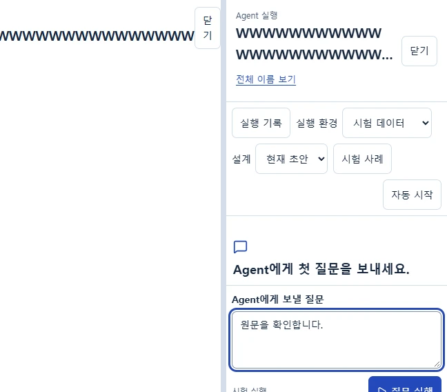

# UI 검증 결과

## 2026-11-27 · 캔버스 연결선 범례와 툴팁

변경 전에는 데스크톱의 41종 도면에서 범례가 **작업 지침·Skill → AI 한 번 작업** 참조선 일부를 가렸다. 변경 후 기본 캔버스와 전체 보기 모두 범례와 툴팁이 도면 아래에 표시된다. **실행 순서**, **전달할 값**, **참조**는 연결 설정과 같은 이름을 쓴다. 두 종류가 함께 있는 선의 툴팁에는 두 이름이 모두 나온다. [변경 전 데스크톱](../.local/canvas-legend-review/visual/before/1440-dense-default.png) · [변경 후 데스크톱](../.local/canvas-legend-review/visual/after/1440-dense-default-tooltip.png)

1440×900과 320×568 Chrome 터치 에뮬레이션에서 5개 블록 도면과 41종 밀집 도면을 각각 기본·전체 보기로 열었다. 모바일에서는 범례를 한 번 눌러 강조를 켜고 다시 눌러 해제했다. 밀집 도면의 전체 보기에서 41개 이름과 연결선 5묶음 모두 직접 누를 지점이 있었고, 선에 키보드 초점을 두어 설명을 열어도 범례·툴팁과 도면이 겹치지 않았다. [320px 전체 보기에서 연 툴팁](../.local/canvas-legend-review/visual/after/320-dense-overview-focused.png) · [화면별 측정](../.local/canvas-legend-review/visual/after/report.json)

320px의 밀집 전체 보기에서 툴팁을 연 상태로 실행한 axe 검사에서 위반이 검출되지 않았다. 선을 눌러 속성을 연 뒤 기본 보기로 돌아온 상태에서는 도면 아래 경계에 3px만 보인 **파일 입력** 블록에 작은 터치 표적 경고 1건이 있었다. 범례 버튼 세 개는 각각 중앙 24×24px의 576개 지점을 모두 직접 선택할 수 있었다. 가로 넘침과 콘솔 오류는 없었다. [기본 보기 복귀 화면](../.local/canvas-legend-review/visual/after/320-dense-overview-wire-return.png)

최종 프로덕션 빌드 `u0xN-uurJlLHEbq4cjB8R`에서 타입 검사, 단위 테스트 395개, 캔버스 브라우저 회귀 5종이 통과했다. 범례 강조, 블록 이름과 배치, 터치 이동·확대, 키보드 확대, 연결선 선택을 확인했다. 분기 목적지를 키보드로 살펴본 뒤 돌아오면 선택한 행이 원래 화면 위치에 표시됐다. [범례·편집 회귀 테스트](../tests/canvas-editing-browser.ts) · [연결선·분기 회귀 테스트](../tests/canvas-wire-browser.ts)

## 2026-11-27 · 연결 설정에서 실행 순서와 전달할 값 선택

새 연결을 만들고 기존 연결에 전달 항목을 추가할 때 **실행 순서**와 **전달할 값**을 확인했다. 1440×900 데스크톱과 320×568 모바일 터치 에뮬레이션에서 **결과 → 입력값**을 저장한 뒤 **결과 → 원래 질문**을 추가했다. 저장된 그래프에는 실행 순서와 두 데이터 연결이 함께 남았다. 다른 입력인 **검색된 구절**에는 글 요약 예시가 표시되지 않았다. [연결 회귀 테스트](../tests/canvas-connection-edit-browser.ts)

두 예시 모두 각 체크박스의 접근성 설명으로 연결됐다. 데스크톱에서는 Tab과 Space로 선택했고 모바일에서는 예시 문구를 직접 눌러 선택했다. 320px에서 첫 예시는 한 줄, 둘째 예시는 두 줄로 표시됐다. 두 화면에서 문구 잘림, 가로 넘침, 콘솔 오류 및 axe 자동 검사 위반은 0건이었다. [모바일 변경 전](../.local/connection-wording/before/320-settings.png) · [모바일 변경 후](../.local/connection-wording/after/320-settings.png) · [데스크톱 변경 후](../.local/connection-wording/after/1440-settings.png) · [측정 기록](../.local/connection-wording/after/report.json)

프로덕션 빌드, 타입 검사, 단위 테스트 395개, 편집기 계약 및 전체 앱 브라우저 스모크 테스트가 통과했다. 가이드의 연결 속성 캡처를 갱신한 최종 빌드 `ug7yNeCZkiuNt2lpDUZ0y`에서 연결 설정과 접근성을 다시 확인하고, 가이드의 시각 자료·확대 보기를 320·390·768·1440px에서 검증했다. [연결 속성 가이드 화면](../public/guide/captures/terms-connection.png)

## 2026-11-27 · 블록 속성의 위치 조정과 연결 항목

Chrome 데스크톱 1440×900에서 키보드로, 모바일 320×568에서 터치 에뮬레이션으로 확인했다. **사용자 입력** 블록은 별도 고급 옵션이 없어도 **고급 설정 → 위치 조정**을 열 수 있었고, 오른쪽 방향 버튼을 누르면 X 좌표가 40에서 48로 바뀌었다. **연결 → 연결 가능한 항목 보기**를 펼치면 받는 항목과 보내는 항목이 나타났고, 다시 접어도 **연결 추가** 버튼을 사용할 수 있었다. [데스크톱 위치 조정](../.local/inspector-sections/visual/1440-position.png) · [모바일 위치 조정](../.local/inspector-sections/visual/320-position.png) · [모바일 연결 항목](../.local/inspector-sections/visual/320-ports.png)

두 화면에서 기본 상태, 위치 조정을 펼친 상태, 연결 항목을 펼친 상태를 각각 점검했다. axe 자동 접근성 검사 6회에서 위반이 검출되지 않았고 가로 넘침과 콘솔 오류도 없었다. [화면별 측정 기록](../.local/inspector-sections/visual/report.json)

1440×900과 터치 에뮬레이션 320×640에서 두 메뉴를 접은 채 **입력값 받기**로 데이터 연결을 만들었다. 편집기를 다시 열어 블록을 선택한 뒤 누락 안내가 사라지고 새 연결과 기존 연결이 함께 남은 것을 확인했다. 두 화면에서 직접 입력한 좌표가 저장됐고, 데스크톱에서는 위치 변경을 취소해 이전 좌표로 돌아갔다. 프로덕션 빌드와 타입 검사, 단위 테스트 395개, 관련 브라우저 회귀 4종이 통과했다. [블록 속성 회귀 테스트](../tests/editor-contracts-browser.ts)

## 2026-11-27 · Workflow 편집기 속성 패널의 장문 입력

편집기 캔버스에서 **AI 작업**, **AI 한 번 작업**, **자료 원문** 블록을 선택하고, 팔레트에서 새 AI 블록도 추가해 이전 빌드와 비교했다. 1440px 화면에서 작업 지시의 실제 너비는 241px에서 392px로, 40줄을 입력한 높이는 390px에서 495px로 늘었다. 1024px에서는 입력 폭이 227px에서 267px로, 320px에서는 255px에서 287px로 늘었다. 이름과 작업 방식을 한 줄에 배치하고 작업 지시를 연결 안내보다 먼저 표시한다. 제목 옆 **넓게 쓰기**에서 현재 글을 이어 쓸 수 있다. [속성 패널 전후](../.local/editor-input-audit/comparison.png) · [직전 빌드 측정](../.local/editor-input-audit/before/report.json)

**자료 원문**도 40줄에서 약 207px로 고정돼 있던 입력란에 자동 높이와 크게 쓰는 창을 적용했다. 창에서 작성한 글은 기존 원문 초안으로 복귀한다. **변경 적용** 전후에 저장된 원문과 실제 시험 응답을 대조했다. 편집기의 **시험 실행 → 시험 사례 → 기대 결과** 역시 1440px에서 내용 영역 높이가 53px 고정에서 장문 388px로 커졌다. [자료 원문 전후](../.local/editor-input-audit/source-comparison.png) · [시험 입력란 측정](../.local/editor-input-audit/after/case-fields.json)

최종 빌드 `ekKCVqvZYpVaOq5Cns9pR`에서 320×568px의 작업 지시 시작 위치가 화면 위에서 633px에서 472px로 이동해 선택 직후 본문 세 줄과 확대 버튼이 보였다. 320·1024·1440px의 10가지 진입 사례에서 처음 선택했을 때와 장문을 입력한 뒤 총 20회 직접 눌러 올바른 확대창과 값 복귀를 확인했다. 대표 인라인·확대 상태의 axe 검사 12회에서 위반이 없었고, 가로 넘침과 콘솔 오류도 없었다. 단위 테스트 395개와 정규 브라우저 회귀 6종(편집기 동작, 설계·포커스, 원문 편집·저장, 시험 사례·대화 복원, 캔버스 확대, 제스처)이 통과했다. 타입 검사와 프로덕션 빌드도 통과했다. 모바일은 Windows Chrome 터치 에뮬레이션으로 검증했다. [최종 화면별 측정·터치 결과](../.local/editor-input-audit/final/report.json)

## 2026-11-27 · 긴 AI 질문과 작업 지시 작성

홈의 AI 설계 요청, 편집기의 설계 제안과 블록 작업 지시, 시험 실행 및 공유 Agent의 질문에서 같은 글을 짧게 입력하고 40줄을 붙여넣어 비교했다. 입력한 줄 수와 화면 높이에 따라 칸이 커지고, **넓게 쓰기**를 누르면 같은 내용을 큰 편집창에서 이어 쓴다. **작성 마치기**나 Esc로 돌아가면 변경된 글이 원래 입력란에 남는다. Enter는 줄을 바꾸며 실제 전송은 **질문 실행**이 담당한다. [320px 수정 전·후와 확대 화면](../.local/prompt-input-review/320-prompt-comparison.png)

320×568px 독립 실행 창에서는 긴 글을 붙여넣은 뒤에도 **질문 실행** 버튼이 화면 위에서 516~560px에 모두 보였다. 대기 답변과 검토 의견은 확대창에서 각각 15줄을 작성하고 같은 실행에 회신해 워커가 마지막 줄까지 받는 것을 확인했다. [전송 버튼 위치](../.local/prompt-input-review/compact-compose-final.json) · [회신 결과](../.local/prompt-input-review/run-replies.json)

최종 빌드 `iK2fv_8tihC5IpJaiO-A4`에서 320×568, 390×844, 1440×900px의 다섯 화면을 검사했다. 320px 편집기 시험 질문은 수정 전 79px(3줄)에서 수정 후 기본 124px, 장문 256px(9줄), 확대 487px(17줄)로 바뀌었다. 15개 조합에서 자동 확대·축소, 선택 범위와 내용 유지, 키보드 포커스 복귀가 통과했다. 확대창의 axe 위반과 페이지 가로 넘침, 콘솔 오류는 0건이었다. 시험 질문과 공유 Agent 질문 전송은 6/6회 통과했다. Windows Chrome에서 터치 및 가상 키보드가 가용 높이를 줄이는 조건을 재현했다. 실물 휴대폰에서 OS 키보드를 열어 보는 시험은 수행하지 않았다. [수정 전후 실측](../.local/prompt-input-review/comparison.json) · [최종 실측 및 대체 높이 계산 검증](../.local/prompt-input-review/final/report.json)

프로덕션 빌드와 TypeScript 검사, 단위 테스트 395개, 관련 정규 브라우저 회귀 8종이 통과했다. 회귀 범위는 편집기 설계·포커스, 편집 동작, Agent 업무 범위, 시험 및 공개 실행, 대화 초안과 첨부 복원, 재전송, 대기·검토 회신, 실습별 실행 문맥이다. [설계·키보드 회귀 시나리오](../tests/editor-focus-proposal-browser.ts) · [회신·짧은 화면 회귀](../.local/prompt-input-review/run-checks.json)

## 2026-11-27 · 41종 밀집 도면의 전체 이름과 편집기 헤더

320×740px 도면에서 잘렸던 카드 8개와 320×568px에서 잘렸던 11개 모두 카드 안에 전체 이름이 표시된다. 이름 8개의 중앙과 마지막 글자를 직접 눌러 각각 올바른 속성이 열렸고, Enter로도 8개 모두 열렸다. 저장 연결 8개를 표시한 도면에서 연결선 5묶음과 범례 3종을 확인했다. 320·1440px 편집기 헤더에서 수준 선택기를 제거했다. [수정 전후 화면 5쌍](ui-review/dense-names.html) · [변경 파일·접근성·회귀 결과](ui-review/dense-names.md)

최종 빌드 `WM8RtZ_kb7vvwBZ_BBS-u`에서 320×568px 도면의 axe 작은 표적 지적은 77개에서 0개로 줄었다. 타입 검사·프로덕션 빌드·단위 테스트 395개·정규 브라우저 회귀 스크립트 35개가 통과했다. [측정 및 테스트 집계](../.local/ui-name-review/verification.json)

## 2026-11-27 · 세부 조작과 컴포넌트 검증

[대표 전후 화면 30쌍](ui-review/precision.html) · [작업 PC의 전체 캡처 비교 764쌍](../.local/ui-precision/comparison.html) · [제품·테스트 변경 파일](ui-review/precision-files.md)

320×568px에서 처음 지적된 블록 3개와 출력점 5개를 다시 측정한 결과, 최종 빌드에서 작은 표적 지적은 0개였다. 직접 누른 60개 위치는 두 회차 모두 의도한 속성이나 연결 창을 열었다. 이 빌드로 프로젝트의 정규 브라우저 시험 35개를 처음부터 끝까지 실행해 통과했다. [320px 전후 화면](ui-review/precision-editor-320.webp) · [최종 검증 집계](../.local/ui-precision/delivery-verification.json)

| 검증 | 결과 및 근거 |
|---|---|
| 주요 페이지 두 차례 재검토 | 최종 빌드 `5GJ4v1RvdnbnfWCIj9I_i`. 회차마다 6개 너비에서 주요 화면 123상태, 팝업·서랍 27상태, 폼 복구 6개 흐름을 검사했다. 자동 접근성 위반, 페이지 가로 넘침, 포커스 순환 이탈, 확인 대상의 포커스 복귀 실패, 배경 잠금 실패, 예기치 않은 콘솔·런타임 오류가 모두 0건이었다. [1차](../.local/ui-precision/delivery-1-summary.json) · [2차](../.local/ui-precision/delivery-2-summary.json) |
| 편집기와 실행 | 320~1440px 일곱 너비. 정순 172개·역순 90개 화면/영역의 자동 검사와 양 회차 각각 82개 블록 속성 점검을 수행했다. 밀집 도면 직접 터치 22/22씩, 모달 키보드 순환 35/35씩 통과했다. [화면별 수치·재현법](ui-review/precision-editor.md) |
| 홈·실습·가이드 | 6개 너비의 각 240개 상태를 두 차례 확인했다. 대표 30개 상태씩 axe 지적 0건. 가이드 36장은 다시 촬영했으며 원본 30장의 강조 좌표를 대조했다. 최신 UI 통합 과정에서 360·1440px의 그림 확대, 복귀, 이전 시안 가져오기와 본문 건너뛰기도 별도로 확인했다. [가이드 보고서·이미지 출처](ui-review/precision-guide.md) · [이전 시안과 본문 이동](../.local/ui-precision/guide/deep-links-final/legacy-and-skip.json) |
| 계정·자료·공유·휴지통·개발 시안 | 최종 편집기 기하 보정 전의 동일 UI에서 198개 상태씩 두 차례 확인했다. axe 위반·가로 넘침·예상 밖 오류 0건. 일반 회차마다 키보드 순환 42회, 고정 푸터 30회 확인. 운영자 권한, 초안 충돌, 파일 선택·다운로드, 실패 후 복구를 포함한다. [자료 화면 검증과 검사 범위](ui-review/precision-data.md) · [요약](../.local/ui-precision/data/summary.json) |
| 최종 소스·타입·단위·빌드 | 빌드 `5GJ4v1RvdnbnfWCIj9I_i`의 소스·정적 파일·테스트·스크립트·설정 365개가 작업 폴더와 일치했다. `pnpm typecheck`, 증분 캐시 없는 TypeScript 검사, `pnpm test` 394개 및 `pnpm build`가 통과했다. 패키지에 독립 lint 스크립트가 없다. [소스 대조](../.local/ui-precision/source-check.json) · [타입 검사](../.local/ui-precision/typecheck-delivery.log) · [단위 결과](../.local/ui-precision/unit-delivery.log) · [빌드](../.local/ui-precision/build-delivery.log) |
| 정규 브라우저 회귀 | `pnpm test:browser` 35/35, 종료 코드 0. 격리한 DB와 실제 워커를 사용해 17분 50초간 생성·공유·가이드·편집기·직접 터치·대용량 가져오기·시험 실행·자료·자동 시작까지 순서대로 실행했다. [전체 출력](../.local/ui-precision/delivery-suite.log) · [명령과 시작·종료 시각](../.local/ui-precision/delivery-suite-result.json) |
| 전달한 화면 비교 | 대표 갤러리를 320·360·390·768·1024·1280·1440px에서 직접 열어 모든 이미지 디코딩, 원본 크기 전환, 가로 넘침, axe 및 외부 요청을 확인했다. [원본과 상세 쌍 수](../.local/ui-precision/publication.json) · [갤러리 검증](../.local/ui-precision/gallery-check.json) |
| 편집기 한글 조합 입력 | 360·1440px의 입력 항목 추가와 분류 이름 변경 4/4 통과. 조합 중 Enter로 원래 항목이 유지되고, 다음 Enter에서 한 번만 저장됐다. 분류명을 바꾼 뒤 기존 연결 ID·목적지와 연결 수 27개가 보존됐다. Chrome 개발자 프로토콜로 조합을 발생시켰으며 실제 운영체제 자판은 시험하지 않았다. [입력 이벤트와 저장 결과](../.local/ui-precision/guide/delivery-ime/ime.json) |

### 직접 누르기와 시각 비교의 기준

320×568px **내 자료로 안내하기 → 전체 보기**의 최초 비교에서는 작은 표적이 블록 본체 3개와 출력점 5개였다. 이번 정밀 검토를 시작할 때 보관한 빌드에는 이 8개의 앞선 수정이 이미 적용되어 있었다. 같은 실습의 총 6개 블록, 출력점 5개, 연결 8개를 계속 시험하고, 별도로 41종 블록을 한 도면에 놓은 320px 상태와 768·1024px 실습도 측정했다. 자동 검사는 axe-core의 WCAG 2 A·AA, 2.1 A·AA, 2.2 AA 태그를 사용했다. 실제 터치는 Chrome의 터치 에뮬레이션으로 누른 뒤 열린 대상까지 대조했다. [기존 8개 전후 화면](ui-review/editor-touch.html) · [W3C 표적 크기](https://www.w3.org/WAI/WCAG22/Understanding/target-size-minimum.html) · [키보드 포커스 가림](https://www.w3.org/WAI/WCAG22/Understanding/focus-not-obscured-minimum.html)

### 320px 직접 터치 결과

빌드 `5GJ4v1RvdnbnfWCIj9I_i`에서 같은 실습을 320×568px, 전체 보기 30% 배율로 두 번 열어 측정했다. 블록 본문을 누르면 열린 속성의 이름을, 출력점을 누르면 연결창의 출발 블록을 확인했다. [최초 수정 전 실측](../.local/ui-touch-review/before/report.json) · [최종 1차](../.local/ui-touch-review/after-precision-delivery-1/report.json) · [최종 2차](../.local/ui-touch-review/after-precision-delivery-2/report.json)

| 기본 실습에서 측정한 항목 | 최초 수정 전 | 최종 결과 |
|---|---|---|
| axe 표적 크기 지적 | 블록 3개, 출력점 5개 | 0개 |
| 블록 6개 본문의 눌리는 영역 | 높이 13.8~19.8px | 너비 34.1~52.1px, 높이 34.7~37.4px |
| 출력점 5개의 눌리는 영역 | 7.2×7.2px | 너비 28px, 높이 34.7~37.4px |
| 본문·출력 중심에서 가로·세로로 10px 벗어난 네 지점 | 의도한 요소 2/44 | 44/44 |
| 실제 누른 뒤 열린 대상 | 최초 빌드에서 성공 횟수 미측정 | 중앙 11회, 주변 44회, 보이는 출력점 5회 모두 일치 |
| C안 연결도 | 블록 6개, 저장 연결 8개 | 6개 이름 모두 표시. 연결선 5묶음 선택·범례 3종 전환 성공. 도선 끝과 표시된 포트 중심의 최대 차이 0.007px 미만. 저장 그래프 동일 |

별도의 41종 밀집 도면에서는 이번 검토 시작 시 3개가 지적됐다. 최종 빌드에서는 0개였고 분류·분기 본체, Workflow 출력점, 인접 Skill 및 이웃 컨트롤에 대한 실제 터치가 회차마다 22/22회 올바른 대상을 열었다. 작은 카드 8개에는 온전한 줄 단위로 말줄임을 표시한다. 같은 화면의 블록 선택기에 41개 전체 이름이 있다. [밀집 도면 1차](../.local/ui-precision/editor/delivery-dense-1/report.json) · [2차](../.local/ui-precision/editor/delivery-dense-2/report.json)

### 수정 도중 발견한 회귀와 조치

- 연결점을 눌렀다 뗄 때 모바일 연결창이 열린 직후 배경 클릭을 받아 닫히는 현상을 재현했다. 모달을 닫는 포인터 동작이 실제 배경에서 시작됐는지 확인하도록 보완했다. 단순히 요소 경계에 좌표가 들어간다는 측정만으로 직접 터치 성공을 판정하지 않는다.
- 설계 JSON을 가져올 때 중간 빌드에서는 2,521,049바이트 파일을 읽은 뒤 18초 안에 **현재 초안에 적용**을 누를 수 없었다. 원문 입력창의 스타일을 좁혀 수정했다. 기본 파일을 취소한 후 다시 열기, 파일 읽기 경합, Ctrl+V 우선, 같은 대용량 파일 재선택과 10번째 줄 직접 편집, 전체 내용 저장을 최종 빌드에서 확인했다. [표준 회귀에서 재현된 실패](../.local/ui-precision/verified-suite.log) · [6개 편집·저장 경로](../.local/ui-precision/editor/import-contracts-delivery.json)
- 새 공유 설정 섹션과 공개 범위 입력이 같은 접근 가능한 이름으로 검색돼 기존 회귀 시험이 중단됐다. 선택 상자와 보이는 라벨을 명시적으로 연결했다. 수정 빌드에서 실제 두 계정의 공유 설정, 게시, 철회, 복구와 영구 삭제가 포함된 작업실 브라우저 시험을 통과했다. [발견 기록](../.local/ui-precision/candidate-smoke.log) · [재시험](../.local/ui-precision/release-smoke.log)
- 모바일 자료 유형 선택기를 압축하면서 각 버튼에서 읽을 수 있던 종류 설명도 사라지는 문제가 발견됐다. 화면에는 선택한 자료의 설명을 표시하고 보조기기에서 각 버튼의 뜻을 읽을 수 있도록 수정했다.
- 중간 빌드의 전체 회귀를 여러 검증과 동시에 실행했을 때 공유 주소로 로그인한 뒤 **Agent 사용** 버튼을 기다리는 5초가 한 차례 만료됐다. 같은 경로는 독립 작업실 스모크에서 통과했다. 첫 만료의 원인은 확정하지 못했다.
- 최종 결과에 실물 기기의 터치 보정이나 화면 낭독기 음성 검사는 포함되지 않는다. 외부 모델을 호출하는 유료 실사용 시험은 수행하지 않았다. 가이드의 당시 실제 모델 응답 캡처는 출처를 표시해 보존했다.

저장소에 포함한 대표 화면 비교에는 같은 화면 크기로 촬영한 홈·실습·편집기·실행·자료함·404의 전후 캡처가 들어 있다. HTML 파일 하나만으로 오프라인에서 열 수 있다. [대표 화면 비교](ui-review/index.html) · [재현 명령과 검증 환경](ui-review/README.md)

최초 디자인 개편 전후 캡처 75쌍과 후속 개선 177쌍은 작업 PC에도 따로 보관했다. 아래 경로 중 `.local`은 이 PC의 상세 자료를 가리킨다. 기능 시험은 격리 SQLite 데이터와 제품 API·워커를 사용했다. 패키지에는 독립 lint 명령이 없다. [최초 화면 비교](../.local/ui-redesign-20261126/comparison.html) · [이전 검증 기록](VERIFICATION.md) · [프로젝트 검증 명령](../README.md#verification)

## 2026-11-27 편집기 전체 보기 직접 터치

320×568px에서 **내 자료로 안내하기** 실습을 열고 **전체 보기**를 선택했다. 이전 빌드 `w2RBf5kthjSa1dPE22tbC`와 수정 빌드 `JgaxZ_6K2R6MwLj_4K6vW` 모두 같은 30% 배율에서 측정했다. Windows Chrome의 모바일 터치 에뮬레이션을 사용했다. [같은 크기의 전후 화면](ui-review/editor-touch.html) · [수정 전 실측](../.local/ui-touch-review/before/report.json) · [수정 후 실측](../.local/ui-touch-review/after/report.json)

| 측정한 항목 | 수정 전 | 수정 후 |
|---|---|---|
| axe-core 4.10.3의 WCAG 2.2 AA `target-size` 지적 요소 | 블록 3개, 출력점 5개 | 0개. 같은 화면에서 검사한 다른 WCAG 규칙의 위반도 0개 |
| 도서관 안내 Agent / 근거 인용 Skill 본체 | 각각 52.12×13.78px | 각각 34.12×37.40px / 34.12×31.75px |
| 도서관 이용규정 본체 | 65.30×19.77px | 47.30×37.40px |
| 단일 출력점 5개 | 각각 7.19×7.19px | 너비 28.00px, 높이 31.75~37.40px |
| 11개 버튼 중심에서 가로·세로 10px씩 벗어난 네 위치의 실제 요소 판별 | 2/44 | 44/44 |

수정 후 버튼 중앙 11곳, 위 네 방향의 모서리 44곳, 화면에 그려진 출력점 중심 5곳을 각각 직접 터치했다. 60회 모두 해당 블록의 속성 창이나 그 블록을 출발점으로 하는 연결 창이 열렸다. 블록 6개의 전체 이름과 저장 그래프의 연결 8개를 확인했다. 다섯 연결선 묶음을 각각 눌러 의도한 경로가 선택됐고 실행·데이터·참조 범례를 전환했다. 선의 시작·끝과 표시된 포트 중심의 차이는 최대 0.007 CSS px였다. 320·390·1440px에서 페이지 가로 넘침, 예상 밖 콘솔·런타임 오류는 없었다. 390px의 같은 실습에서 작은 표적 지적은 7→0개, 1440px는 0→0개였다. [터치 회귀](../tests/canvas-gesture-browser.ts) · [390px 실측](../.local/ui-touch-review/after-390/report.json) · [1440px 실측](../.local/ui-touch-review/after-1440/report.json)

**다른 밀도의 설계.** 41종 블록을 다섯 열에 놓은 320×740px 도면도 비교했다. 작은 표적 지적은 75→3개였다. AI 분류·조건 분기 본체와 호출 가능한 Workflow의 출력점이 남았다. 좁은 간격을 보존한 이 도면에서는 블록 선택기로 속성과 이름 있는 출력 경로를 여는 별도 44개 조합을 두 번 확인했다. 실물 스마트폰과 화면 낭독기 음성은 이번 시험 범위에 포함되지 않았다. [밀집 도면 실측](../.local/ui-continuous/editor/touch-final-broad.json) · [동등 조작 시험](../.local/ui-continuous/editor/touch-dense-retest-equivalent.json) · [W3C 표적 크기 기준](https://www.w3.org/WAI/WCAG22/Understanding/target-size-minimum.html)

| 수정 빌드 검증 | 결과 |
|---|---|
| 타입 검사 | `pnpm typecheck`와 증분 캐시 없는 `tsc --noEmit --incremental false` 모두 종료 코드 0. [일반](../.local/ui-touch-review/typecheck.log) · [캐시 미사용](../.local/ui-touch-review/typecheck-cold.log) |
| 단위·통합 시험 | `pnpm test` 393개 모두 통과. 실패·취소·건너뜀 0개. [시험 기록](../.local/ui-touch-review/unit.log) |
| 프로덕션 빌드 | `pnpm build` 종료 코드 0. [빌드 기록](../.local/ui-touch-review/build.log) |
| 캔버스 제스처 회귀 | 320px 직접 터치, 390·768·1440px의 기존 확대·이동·연결·취소 확인. 저장된 그래프와 리비전 보존. [실행 기록](../.local/ui-continuous/touch-final-direct-test-canvas-gesture-browser.log) |
| 전체 브라우저 회귀 | 같은 프로덕션 빌드와 새 격리 DB에서 `pnpm test:browser` 재실행. 스크립트 35개 모두 통과, 종료 코드 0. [전체 실행 기록](../.local/ui-continuous/touch-release-suite.log) |

전체 브라우저 회귀의 첫 실행에서는 800px에서 설계를 가져온 뒤 **내 Agent** 제목이 표시되기를 기다리다 5초를 넘겼다. 해당 절차는 전체 보기를 열지 않는다. 같은 빌드에서 단독 재실행 3회와 저장 응답을 750ms 지연한 1회가 통과했다. 이전 보관 빌드에서도 일반·지연 실행이 통과했다. 첫 대기 만료의 원인은 특정하지 못했다. [첫 전체 실행](../.local/ui-continuous/touch-final-suite.log) · [단독 재실행](../.local/ui-continuous/touch-menu-verified-named-probe-menu.log) · [지연 시험](../.local/ui-continuous/touch-menu-latency-named-probe-menu-slow.log)

## 2026-11-27 직접 터치 개선 전 인계 빌드 검증

작업실 화면을 검토하는 동안 별도로 변경된 실행 엔진과 내보내기 코드까지 포함해 루트 프로젝트를 다시 빌드했다. 빌드 ID는 `w2RBf5kthjSa1dPE22tbC`다. 이전 화면 검토에 사용한 빌드와 UI·라우트·정적 파일·브라우저 실행기 186개의 해시가 일치했다. [작업 트리 대조](../.local/ui-continuous/nov27-inputs-finish.json)

| 명령 | 관찰한 결과 |
|---|---|
| `pnpm typecheck` | 종료 코드 0. [타입 검사](../.local/ui-continuous/guide-handoff-verified-type.log) |
| `pnpm exec tsc --noEmit --incremental false` | 증분 캐시 없이 종료 코드 0. [추가 타입 검사](../.local/ui-continuous/guide-handoff-verified-cold.log) |
| `pnpm test` | 단위·통합 시험 390개 통과. 실패, 취소, 건너뜀 모두 0개. [시험 로그](../.local/ui-continuous/guide-handoff-verified-unit.log) |
| `pnpm build` | Next.js 프로덕션 빌드 성공. `/`, `/login`, `/api/studio`, `/api/events/[id]`, `/prototype/library`와 404가 빌드 목록에 있다. [빌드 로그](../.local/ui-continuous/guide-handoff-build.log) |
| `pnpm test:browser` | 35개 스크립트 모두 통과, 종료 코드 0. 격리 SQLite와 제품 워커를 사용해 가이드 그림, 편집·실행·자료, 보호된 공유 MCP의 권한 철회, 이벤트와 예약 실행까지 확인했다. [회귀 로그](../.local/ui-continuous/guide-handoff-suite.log) |
| lint | 패키지에 독립 실행 스크립트가 없다. [프로젝트 명령](../package.json) |

중간 회귀에서 동적 실습의 필수·선택 목록을 한 번에 찾는 검사와, 분류 출력이 두 개인 블록의 연결을 즉시 저장한다고 가정한 검사가 실패했다. 실습 제목 다음의 필수 단계, **연결 추가**에서 선택한 출력과 입력을 각각 확인하도록 시험을 맞췄다. 설정을 저장한 뒤 원래 연결과 결과를 확인하는 검사는 유지했다. [회귀 시험](../tests/browser-smoke.ts) · [실습 목록 재검증](../.local/ui-continuous/lesson-list-verified-named-probe-lesson.log) · [출력 연결 재검증](../.local/ui-continuous/current-reservation-named-probe-issued.log)

## 2026-11-27 직접 터치 개선 전 전체 화면 검토

실습 안내를 현재 실습부터 읽도록 고친 뒤 두 번 검토했고, 인계 빌드 `w2RBf5kthjSa1dPE22tbC`에서 전체 검토를 두 번 더 실행했다. 아래 표는 인계 빌드의 마지막 두 회차다. 각 회차의 계정·SQLite·서비스 포트가 다르다. [인계 빌드의 두 회차](../.local/ui-continuous/rounds-guide-handoff-one-guide-handoff-two.json) · [앞선 두 회차](../.local/ui-continuous/rounds-guide-last-one-guide-last-two.json)

| 관찰한 항목 | 1회차 | 2회차 |
|---|---:|---:|
| 320·390·768·800·801·1024·1440px의 화면·너비 조합 | 144 | 144 |
| 공통 탐색·제목·뒤로 가기·키보드 조작 | 46 | 46 |
| 공통 화면의 axe 검사 상태 | 41 | 41 |
| 페이지 가로 넘침, 예상 밖 콘솔 경고·오류, 런타임 예외 | 0 | 0 |
| 320px 편집기 전체 보기의 작은 블록·연결점 지적 | 8 | 8 |
| 추가로 점검한 가이드 기본 화면 / 1.5배 확대 화면 | 8 / 32 | 8 / 32 |
| 이 두 회차에서 새로 확인한 사용자 화면 결함 | 0 | 0 |

320px의 작은 블록·연결점은 같은 화면의 일반 크기 선택기와 속성·연결 조작으로도 사용할 수 있다. 자동 검사의 원시 지적은 두 회차에 그대로 남겼다. 가이드 확대 조작은 64회 모두 원래 배율·원래 버튼의 포커스로 복귀했다. 처음 홈에서 받은 정적 JavaScript는 동일한 Chrome에서 압축 해제 기준 1,020,439바이트에서 752,337바이트로 26.3% 줄었다. [첫 회차 그림](../.local/ui-continuous/guide-handoff-one-illustrations/report.json) · [둘째 회차 그림](../.local/ui-continuous/guide-handoff-two-illustrations/report.json)

## 2026-11-27 그림으로 배우는 가이드

| 시각 자료 | 검증한 내용 |
|---|---|
| Agent의 개념 | 가이드에서 일반 채팅과 이 작업실의 차이를 펼쳤다. 삽화 세 장면과 한국어 설명은 방문자가 회원증 준비물을 묻고, 안내원이 규정을 읽고, 신분증을 안내하는 같은 순서였다. 삽화 원본은 1050×375px WebP 31,704바이트다. |
| 생성 방법 | **내 Agent → 새 Agent**에서 이름을 입력하고 **수준별 템플릿에서 시작 → 질문에서 답변까지**를 골랐다. 실제 개인 사본과 편집기의 작업 지시를 확인하고 이 흐름을 다섯 장으로 촬영했다. |
| 사용 방법 | 세 단계 각각에 한국어 동작, 번호, 실제 조작 대상을 가리키는 화살표가 있다. 단계 이동과 그림 확대를 별개로 조작할 수 있다. 생성·실행 그림 8개의 확대·축소·닫기와 포커스 복귀가 네 너비의 32개 조합에서 통과했다. |
| 기능별 안내 | **기능·용어**에서 편집기, 도구 및 자료, 시험 실행, 버전과 공유의 역할을 확인했다. 어느 단계에서 원문을 연결하고 어느 판을 게시하는지 읽을 수 있다. |
| 업무 사례 | **목적별로 만들기**의 업무 도우미·문서 정리·정보 조사·반복 업무에서 입력과 예시 결과를 확인했다. 각 사례의 실제 미리보기를 열고 뒤로 갔을 때 선택과 링크 포커스가 네 너비의 16개 조합에서 복구됐다. |
| 문제 해결 | 질문 실행 차단, 원문 입력 누락, 이전 답변과 새 답변, 모델 연결 전후를 비교했다. 모델 연결 도움말은 아직 모델을 연결하지 않은 계정에서 표시된다. |

320·390·768·1440px의 실제 Chrome에서 그림을 확대하고, 작은 화면에서는 키보드로 내부를 스크롤했다. 열었던 버튼으로 돌아오는지 Escape와 **닫기**로 각각 확인했다. 생성·실행 그림을 모은 두 화면에서 진행한 axe 검사는 네 너비 모두 위반 0건이었다. 그림에 실제 인증 정보나 개인 계정 주소를 포함하지 않았다. [그림과 확대 검증](../.local/ui-continuous/guide-release-visuals-test-guide-visuals-browser.log) · [생성·실행 그림 계측](../.local/ui-continuous/nov27-final-guide-illustrations/report.json) · [사례별 실제 복귀](../.local/ui-continuous/visual-final-captures/observations.json) · [FigJam 작업 흐름도](https://www.figma.com/board/UfGEEVFYyMVIeMgi7Obst1)

최종 그림 갤러리에는 모바일과 데스크톱에서 실제 촬영한 그림 24장과 첫 가이드 개편 전후 캡처 22장이 있다. 모델 미연결 계정에서 첫 도입과 세 단계 그림의 노출 텍스트는 390px와 1440px 모두 544자였다. 시작·확대 버튼과 단계 번호를 포함하며, 캡처 비트맵 안의 글자는 제외했다. 실제 초보자의 이해 시간과 실습 전환율은 측정하지 않았다. [최종 그림과 초판 비교](ui-review/guide.html) · [노출 텍스트 측정 기준](../.local/ui-continuous/guide-release-reading.json)

최종 루트 빌드에서도 개념·기능·네 업무 사례·네 FAQ를 320px와 1440px에서 각각 1.5배로 확대했다. 20개 대화상자에서 키보드로 열기·닫기와 포커스 복귀를 확인했고 axe의 위반은 0건이었다. 자동 색 대비 판정이 보류된 85개 요소의 실제 CSS 글자색과 단색 배경을 대조한 결과는 6.435:1~15.041:1이었다. 캡처 이미지 내부의 글자는 이 수치에서 제외했다. 모델 설정이 존재하는 표시 분기는 격리 환경값을 넣어 검증했다. 가이드의 준비사항에는 **모델 설정됨**이 표시됐고 FAQ는 세 개였다. 모델 실행과 외부 요청은 모두 0건이었다. [확대 모달의 원시 검사](../.local/ui-continuous/guide-final-dialog-axe.json) · [모델 설정 표시 분기](../.local/ui-continuous/guide-final-model-presentation.json)

## 2026-11-27 첫 방문 가이드 초판

첫 화면에서 **예제로 시작하기**를 누른 뒤 도서관 규정을 읽는 안내원을 열었다. 모델을 연결하지 않은 독립 계정별로 실제 입문 실습 사본 1개가 생겼고 자동으로 시작된 실행은 0개였다. 실습 중 사용할 질문과 기대할 답변 예시를 먼저 읽을 수 있다. [가이드 전후 비교](ui-review/guide.html) · [가이드 사용법](FIRST_WORKFLOW_GUIDE.md)

| 동작 | 실제로 확인한 결과 |
|---|---|
| 첫 방문과 좁은 화면 | 320×568px에서도 시작 버튼 전체가 첫 화면에 들어왔다. 320·390·768·1440px에서 가로 넘침, 예상 밖 콘솔 경고·오류와 런타임 예외가 없었다. |
| 세 단계 그림으로 이동 | **시험 실행 열기**, **질문 보내기**, **답변 확인하기**를 키보드로 열면 각각 2·3·4단계 주소로 이동했고 해당 제목에 포커스가 놓였다. 실제 제품에서 촬영한 세 그림을 각 너비에서 불러오고 대체 텍스트를 확인했다. |
| 질문 예시·도움말 | 두 질문을 비교한 뒤 FAQ 세 개에서 해당 도움말로 이동했다. 이미 로드한 FAQ는 네트워크를 끊은 뒤에도 펼쳐졌다. 첫 화면과 FAQ를 펼친 상태의 axe 위반은 네 너비 모두 0건이었다. |
| 자신의 업무로 이어가기 | **회의 메모로 회의록 만들기**는 메모가 포함된 회의록 설계를 열었다. **내 자료로 안내하기**는 해당 실습 상세로 이동했고 가이드로 돌아올 수 있었다. |
| 복사 권한 응답 지연 | 화면을 옮겨 직접 선택한 질문이 이전 작업 지시로 바뀌던 상황과, 다시 발급된 토큰에 이전 복사의 성공 안내가 뜨던 상황을 재현했다. 수정 후 두 경우 모두 새 선택과 현재 토큰의 표시 상태를 보존했다. |

가이드 첫 방문을 별도 데이터베이스로 두 번 점검했다. 핵심 소개와 세 단계는 공백 포함 약 436자다. 1~2분은 이 부분을 읽고 사용할 순서를 파악하도록 정한 목표다. 실제 초보자의 소요 시간과 실습 전환율은 측정하지 않았다. [가이드 1차 관찰](../.local/ui-continuous/novice-after/review.json) · [2차 조작 기록](../.local/ui-continuous/novice-paths/review.json) · [브라우저 회귀 시험](../tests/workflow-guide-browser.ts)

## 2026-11-27 상호작용 재검증

| 실제 브라우저 조작 | 수정 전 | 수정 후 |
|---|---|---|
| 로그인 요청 도중 연결 끊기 | 390·768·1440px 모두 영문 `Failed to fetch` | 세 너비 모두 입력을 유지하고 한국어로 네트워크 연결과 작업실 서버 상태를 안내한다. 응답이 있는 인증 오류와 구별한다. |
| 클립보드 API 없이 게시 주소 복사 | 세 너비 모두 영문 자바스크립트 오류가 나오고 사용자가 주소를 얻을 수 없었다. | 세 너비에서 **현재 공유 주소**로 포커스가 이동하고 전체 주소를 선택했다. 화면 가로 넘침은 0px였다. |
| **내 사본 만들기** 직후 브라우저 뒤로 가기 | 200 응답이면 편집기로 다시 이동했고 503이면 도착한 목록에 이전 요청 오류가 표시됐다. | 1440px에서 두 응답 모두 **내 Agent** 목록에 머물렀다. 200은 비공개 사본 1개, 503은 사본 0개와 이전 요청 오류 0건이었다. |

수정 전에는 11월 26일과 입력 해시가 같은 빌드를, 수정 후에는 현재 루트 프로젝트의 프로덕션 빌드를 사용했다. 공유 설정 캡처의 주소 필드는 시험 주소를 가렸다. 사본 생성의 성공 사례는 실제 서버에 저장한 뒤 목록과 저장 개수를 대조했다. [통신·복사 전](../.local/ui-continuous/nov27-before/interactions.json) · [통신·복사 후](../.local/ui-continuous/nov27-one/interactions.json) · [사본 요청 전](../.local/ui-continuous/nov27-copy-before/observations.json) · [사본 요청 후](../.local/ui-continuous/nov27-copy-after/observations.json)

세 동작의 수정 전후 화면 8쌍에 가이드 문장 선택과 이벤트 토큰 재발급 2쌍을 더했다. 390·768·1440px에서 실제 로그인 오류와 공유 주소 수동 복사 상태에 WCAG 관련 axe 규칙을 적용한 6건에서 위반은 0건이었다. 비교 파일에 내장한 20장은 320·390·768·1440px에서 키보드와 기본·확대 보기로 확인했다. [복구 동작 전후 비교](ui-review/recovery.html) · [제품 접근성 검사](../.local/ui-continuous/nov27-accessibility/accessibility.json)

### 가이드 개편 전 두 차례의 중간 검토

| 격리 데이터베이스로 각각 관찰한 항목 | 첫 번째 | 두 번째 |
|---|---:|---:|
| 320~1440px의 7개 너비에서 실제 화면·너비 조합 | 144 | 144 |
| 경로·제목·뒤로 가기·키보드 조작 | 46 | 46 |
| 주요 화면의 모바일·데스크톱 자동 접근성 검사 | 41 | 41 |
| 페이지 가로 넘침, 예상 밖 콘솔 경고·오류 및 런타임 예외 | 0 | 0 |
| 320px 기본 실습 연결도의 작은 조작 대상 경고 | 8 | 8 |

두 회차의 작은 조작 대상은 전날 확인한 블록과 연결점이었다. 같은 화면의 일반 크기 선택기와 속성·연결 버튼으로 같은 작업을 수행할 수 있다. 두 회차의 홈 초기 정적 JavaScript는 압축 해제 기준 825,095바이트로, 최초 기준 1,020,439바이트보다 19.1% 적었다. 두 회차에서 새로 재현된 제품 문제는 없었다. [회차별 결과](../.local/ui-continuous/rounds-nov27-one-nov27-two.json)

## 2026-11-26 페이지와 상태

| 진입 화면 | 직접 확인한 내용 | 확인 방법 |
|---|---|---|
| 로그인·가입, 잘못된 주소 | 키보드 가입, 원래 경로로 복귀, 화면별 문서 제목, 한국어 404와 작업실 링크 | Chrome에서 실제 폼·링크 조작, HTTP 상태와 브라우저 이력 대조 |
| 홈·편집기 선택·내 Agent·공유 Agent | 첫 방문과 재방문, 검색 초기화, 긴 제목, 생성·가져오기·삭제·복원, 비공개 초안 실행과 사본, 공개판 사용 | 전용 계정과 저장된 그래프, 계정별 권한 회귀 시험, 모바일 메뉴·데스크톱 탐색 |
| 수준별 템플릿·실습·가이드 | 13개 실습의 순서·완료 기준, 6개 가이드 섹션, 빈 검색 결과, 강제 색상·캡처 확대·단계 복원 | 320·768·1440px에서 회당 123개 관찰을 독립 계정으로 2회, 텍스트 대비 934쌍의 최저값 5.74:1 |
| 편집기·전체 보기 | 41개 블록 유형의 선택·속성, 연결 경로, 내보내기·입력·복구 대화상자, 자동 시작과 버전 조회 재시도 | 회당 141개 상태에서 페이지와 패널 내부 넘침을 점검. 폭 3종에서 블록·분기별 동등 조작 132건 확인 |
| 버전·공유·판단 | 권한별 범위와 링크, 게시·철회·복원, 시험 이력 조회 장애, 판단 저장 중 이중 입력, 공개 범위 재선택 | 소유자·다른 계정의 실제 API 응답, 장애와 지연을 재현한 브라우저 회귀 |
| 자료 목록·상세·공유·휴지통 | 자료 등록·수정·취소 후 포커스, 첨부·판 선택·사본·철회, 긴 원문을 끝까지 읽고 수정으로 이동 | 문서 520개 조항을 유지한 채 320px에서 관리 영역 시작 위치가 28,415→648px, 768px에서 14,384→812px로 이동 |
| 시험 실행 | 초안·게시판, 진행·기록·결과·근거와 내려받기, 긴 이름과 닫기, 중단 후 복구 | 제품 워커와 기존 회귀 시험, 모바일 결과·첨부 비교 |
| 개발용 도서관 시안 | 홈·편집·미리보기, 좁은 화면의 탐색, 결과·속성 포커스, 프로덕션 접근 차단 | 개발 서버에서 3개 너비 × 3개 화면의 axe 검사. 수동 확인한 실제 색 조합·배경 패턴의 보수적 최저값 5.00:1 |

아래는 320px 너비에서 같은 긴 이름의 Agent를 연 결과다. 비교를 위해 두 실제 캡처의 상단 568px를 나란히 놓았다. 왼쪽에서는 이름이 실행 내용을 밀어냈고 오른쪽에서는 첫 질문을 입력하면서 이름도 펼칠 수 있다.

### 접근성 결과 해석

axe-core 4.10.3은 검증 폴더에서만 실행했다. 축소한 실제 캔버스의 블록·연결점은 자동 검사에 작은 대상으로 남는다. 같은 화면에 배율의 영향을 받지 않는 블록 선택기·속성 열기·연결 추가·분기 경로 선택이 있다. 320·768·1440px에서 실제로 눌러 해당 블록과 경로가 열리는지, 닫은 뒤 포커스가 복귀하는지 확인했다. 이는 WCAG의 동일 페이지 동등 조작 조건으로 판단했다. 자동 검사의 원시 지적을 삭제하거나 규칙을 꺼서 집계하지 않았다. [W3C 대상 크기와 동등 조작](https://www.w3.org/WAI/WCAG22/Understanding/target-size-minimum.html)

문서 제목, 이동 순서, 화면 재배치는 제목 문자열·실제 포커스·페이지 및 내부 컨테이너 너비를 함께 확인했다. 화면 낭독기의 실제 음성 출력, Windows 외 운영체제와 실제 터치 기기, 외부 유료 모델 호출은 이번 검증에 포함되지 않았다. [페이지 제목](https://www.w3.org/WAI/WCAG22/Understanding/page-titled.html) · [포커스 순서](https://www.w3.org/WAI/WCAG22/Understanding/focus-order.html) · [재배치](https://www.w3.org/WAI/WCAG22/Understanding/reflow.html)

블록 속성의 위치 입력과 방향 버튼을 포인터로만 눌러 이동하고 저장과 되돌리기를 확인했다. 실제 연결선, 이동 대화상자, 중첩 설계와 복귀 포커스를 포함해 3개 너비에서 18개 시나리오가 통과했다. [W3C 끌기 동작](https://www.w3.org/WAI/WCAG22/Understanding/dragging-movements.html)

## 2026-11-26 두 차례 전체 검토

첫 검토가 끝난 뒤 같은 프로덕션 소스로 새 SQLite와 계정을 만들어 두 번째 검토를 진행했다. 각 회차의 21개 화면 상태를 320·390·768·800·801·1024·1440px에서 열었다. 데스크톱에 없는 모바일 메뉴처럼 적용되는 화면에서만 검사한 조합을 합하면 회당 144건이다. 공통 경로·탭 제목·뒤로 가기·404 조작은 첫 회 1440·768·320px, 둘째 회 1024·800·390px에서 별도로 46건씩 확인했다.

| 항목 | 1회 | 2회 |
|---|---:|---:|
| 화면·너비 조합 | 144 | 144 |
| 공통 경로·메타데이터·복귀 조작 | 46 | 46 |
| 데스크톱·모바일 axe 검사 화면 | 41 | 41 |
| 페이지 가로 넘침·예상 밖 콘솔 오류·경고·런타임 예외 | 0 | 0 |
| 기본 실습 연결도의 자동 대상 크기 지적 | 8 | 8 |
| 기존 동등 조작 외 새로 발견한 유의미한 문제 | 0 | 0 |

첫 홈에서 받은 정적 JavaScript의 압축 해제 크기는 동일한 Chrome 측정에서 1,020,439바이트에서 823,632바이트로 19.3% 줄었다. 전송 압축·네트워크 지연·실사용자 로딩 시간과 구분한 수치다. [회차별 계측 결과](../.local/ui-continuous/rounds-audit1-review2.json)

추가 개선 전후를 화면 32종, 같은 너비의 캡처 177쌍으로 정리했다. 비교 문서에 그림을 포함해 단일 HTML로 열 수 있다. Chrome에서 전체 이미지 354장을 디코딩하고 모바일·태블릿·데스크톱에서 화면 선택기를 바꿔 확인했다. [화면별 전후 비교](../.local/ui-continuous/화면-전후-비교.html)

## 2026-11-26 명령별 결과

Windows에서 Node.js 26.5.0과 pnpm 12.16.1로 실행했다. 루트 프로젝트를 프로덕션 모드로 빌드했다. 브라우저 회귀는 별도 포트와 데이터베이스에서 실행했고, 소스·설정·스크립트·정적 파일 228개의 SHA-256을 대조해 루트 제품과 같은 입력으로 빌드한 것을 확인했다. [빌드 입력 대조](../.local/ui-continuous/release-source.json)

| 명령 | 최종 결과 | 근거 |
|---|---|---|
| `pnpm typecheck` | 종료 코드 0 | [타입 검사 로그](../.local/ui-continuous/typecheck.log) |
| `pnpm test` | 337개 통과, 실패·건너뜀 0개 | [단위·통합 시험 로그](../.local/ui-continuous/unit-final.log) |
| `pnpm build` | 루트 프로덕션 빌드 성공, 종료 코드 0 | [빌드 로그](../.local/ui-continuous/build-root-final.log) |
| `pnpm test:browser` | 브라우저 스크립트 34개 모두 통과, 종료 코드 0. 보호된 공유 MCP, 권한 회수, 이벤트·예약 실행 포함 | [브라우저 회귀 로그](../.local/ui-continuous/delivery-suite-suite.log) |
| `git diff --check` | 소스·테스트·문서의 추적된 변경에서 공백 오류 0건 | 작업 트리 검사 |
| lint | 프로젝트에 독립 실행 스크립트 없음 | [패키지 명령](../package.json) |
